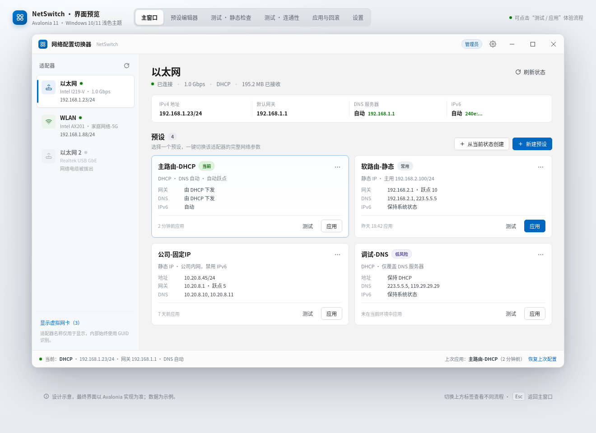
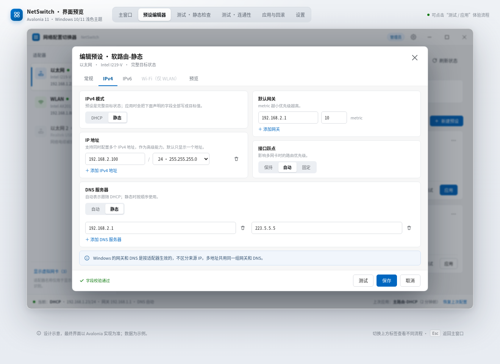
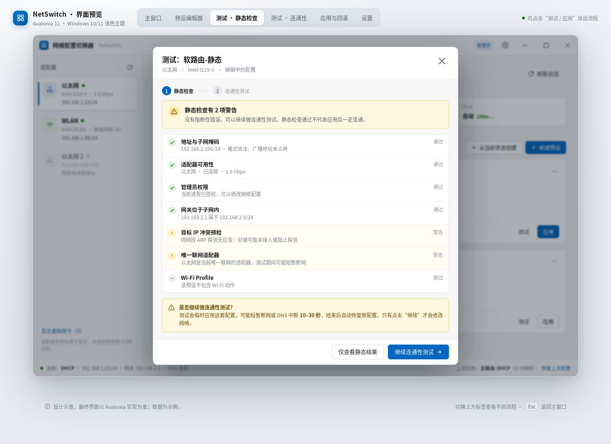
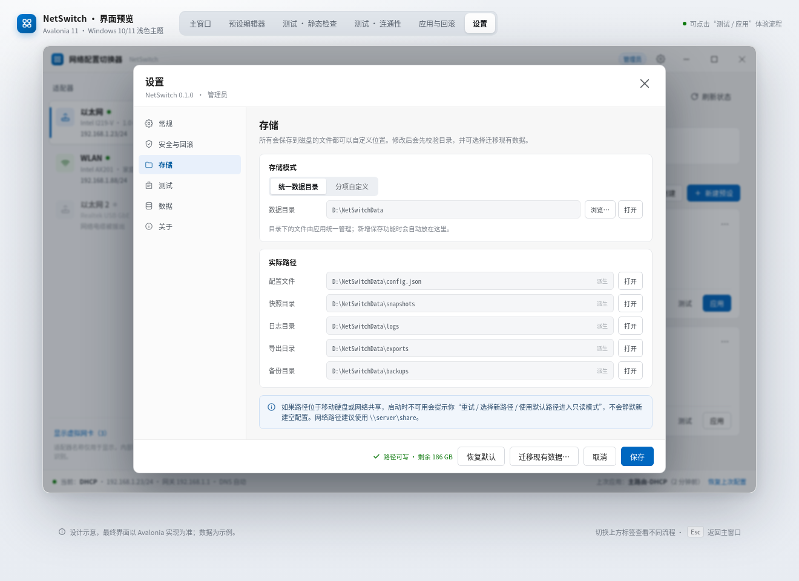

# NetSwitch · 网络配置切换器

为 Windows 10/11 设计的轻量网络适配器配置切换工具。把常用的 IPv4、网关、DNS、IPv6 和 Wi-Fi 组合保存为预设，在软路由故障、临时调试或更换办公网络时一键切换，不必再逐层打开「控制面板 → 网络连接 → 属性」。

> 设计原则：**不调用 `netsh` / PowerShell / `ipconfig` 等外部命令，也不启动外部进程**。正式后端只通过 Windows 系统 API（IP Helper、WMI、INetCfg、WLAN API）读写网络配置。

当前版本为 **M5（Windows 功能开发完成）**：IPv4 通过 WMI / IP Helper 读写，IPv6 通过 INetCfg 控制 `ms_tcpip6` 绑定并通过 IP Helper 写入地址/路由/DNS，Wi-Fi 通过 WLAN API 连接/断开 Windows 已保存的 Profile；另含事务快照、读回校验、失败自动回滚、启动恢复、危险变更自动恢复倒计时、托盘菜单、单实例、日志查看与配置导入导出。所有 Windows 后端代码已编译通过，但本仓库的编译与单元测试环境是 Linux；WMI、INetCfg、IP Helper 与 WLAN 写入仍需在真实 Windows 10/11 上按验收清单验证。在 Linux/macOS 上运行时会自动使用内存模拟后端，便于界面开发与演示。

> IPv6 功能要求 Windows 10 版本 2004（build 19041）或更高；更旧的系统会在静态检查阶段被拦截。

## 界面预览

> 以下为界面设计预览（示例数据），最终界面以 Avalonia 实际渲染为准；可打开 [docs/mockup.html](docs/mockup.html) 查看交互式预览。

<p align="center">
  
  
</p>
<p align="center">
  
  
</p>

## 已实现（M1–M5）

- 适配器列表：以太网 / Wi-Fi / 虚拟适配器，显示在线状态与当前地址。
- 当前状态卡片：IPv4、默认网关、DNS、IPv6。
- 预设管理：新建、从当前状态创建、编辑、删除，每个预设是某块适配器的完整目标状态。
- 「从当前状态创建」会捕获当前适配器的完整配置：IPv4（DHCP/静态地址、网关、DNS、跃点）、IPv6（模式、静态地址、DNS、跃点、绑定状态）与 Wi-Fi 当前连接的已保存 Profile，随后在编辑器中确认后保存。
- 「以此新建」从现有预设复制出一份新预设（不修改原预设），名称自动生成为「原名（副本）」并在冲突时追加序号。
- 一个预设可配置多个 IPv4 地址、多个网关及网关跃点，适配器级 DNS 与接口跃点。
- IPv6：保持系统状态 / 自动获取 / 静态地址 / 禁用 IPv6 绑定。
- Wi-Fi：连接或断开 Windows 已保存的 Profile（应用不读取、不保存密码）。
- 两阶段测试：
  1. **静态检查**（不改变网络）：地址/网关/DNS 合法性、适配器状态、权限、IP 冲突预检、网关是否在子网内、Wi-Fi Profile 是否存在等。
  2. 静态检查后由用户决定是否继续**连通性测试**：临时应用配置 → 网关 Ping、DNS 直连查询、域名解析、公网 TCP → **强制恢复原配置**。
- 应用前差异确认：逐项显示修改前后的值；危险变更显示警告。
- Windows 真实后端（M2）：
  - IPv4 地址（支持多个）、子网掩码、默认网关与网关跃点、DNS、接口跃点；
  - 写入前后均读取系统真实状态，写后**逐项校验**，不一致自动回滚；
  - 操作前写入 `snapshots/pending.json`，程序崩溃/断电后下次启动提示并恢复；
  - 「恢复上次配置」一键撤回到最近一次成功应用之前的状态；
  - 所有写入均有事务历史（`snapshots/history`）与日志（`logs`）；
  - 全程不调用 `netsh` / PowerShell / `ipconfig`，不启动外部进程。
- Windows 真实后端（M3）：
  - IPv6 模式：保持系统状态 / 自动获取 / 静态 / 禁用绑定；
  - 禁用绑定通过 INetCfg 关闭该适配器上的 `ms_tcpip6` 绑定路径（等价于网卡属性里取消勾选 IPv6），并在专用 STA 线程上获取写锁、提交后读回确认；
  - 静态模式通过 IP Helper 写入多个 IPv6 地址、默认网关、IPv6 DNS 与接口跃点；写入前关闭 Router Discovery，避免 RA 再次注入动态地址；
  - 切回自动模式时只删除手动添加的地址/路由，再重新启用 RA/DHCPv6；
  - IPv6 的原始模式（静态/自动/禁用）与 DNS 模式一并写入快照，回滚时无需猜测；
  - 读回校验会忽略系统始终存在的自动链路本地地址（预设显式配置的除外）。
- Windows 真实后端（M4，WLAN API）：
  - 枚举当前用户已保存的 Wi-Fi Profile，只按 Profile 名称连接，**不读取、不保存 Wi-Fi 密码**；
  - `WlanConnect` 是异步的，连接/断开后轮询接口状态直到稳定，超时给出明确错误；
  - 应用顺序为 Wi-Fi → IPv6 → IPv4，便于“先连网络再写地址”；
  - 回滚时先在当前连接与快照一致时跳过重连，避免无意义的断网。
- 体验与安全（M5）：
  - 危险变更分类：修改主 IPv4 地址、默认网关、禁用 IPv6 绑定、在唯一联网适配器上断开 Wi-Fi；仅改 DNS 或增加次要地址视为低风险；
  - 应用成功后按设置显示自动恢复倒计时（关闭 / 仅危险变更 / 始终），倒计时期间每 3 秒探测默认网关并显示可达性，倒计时结束自动恢复，可“保持应用”或“立即恢复”；
  - 托盘图标与动态菜单：按适配器列出预设并勾选当前项、恢复上次配置、刷新、打开主窗口、设置、退出；关闭窗口默认最小化到托盘；
  - 单实例：重复启动会激活已有窗口；
  - 应用内日志查看（按天滚动）：自动刷新、复制选中或全部、删除当前日志或全部日志；日志只记录网络变更与连通性测试过程，不记录预设编辑、设置修改或导入导出；
  - 预设 JSON 导入/导出（同名预设自动重命名，不覆盖）；
  - 设置页：常规（托盘、启动最小化、虚拟网卡、主题）、安全与回滚、存储、测试目标、数据、关于；数据页可清理日志文件、历史快照与配置 `.bak` 备份；
  - 开机自启通过任务计划程序 COM 注册（登录时以管理员权限启动，避免每次 UAC 弹窗）。
- 存储路径全部可自定义：统一数据目录或分项自定义；修改时校验可写性，可迁移现有数据。
- 配置原子写入与 `.bak` 备份；配置损坏时自动回退到备份。
- 中文本地化界面，Windows 11 Fluent 风格，自定义标题栏，管理员权限标识。

## 技术栈

- .NET 10（LTS）/ C# 13
- Avalonia 11.3（跨平台 UI，Windows 为首要目标）
- CommunityToolkit.Mvvm 8.4
- Microsoft.Extensions.DependencyInjection
- System.Text.Json
- xUnit

解决方案文件为 `NetSwitch.slnx`（.NET 10 默认格式）。

## 项目结构

```
src/NetSwitch.Core              业务核心：模型、校验、测试事务、存储、配置
src/NetSwitch.Platform.Fake     模拟后端（内存状态，Linux/macOS/Windows 均可运行）
src/NetSwitch.Platform.Windows  Windows 原生后端（WMI + IP Helper，M2）
src/NetSwitch.App               Avalonia 桌面应用（MVVM、视图、对话框）
tests/NetSwitch.Core.Tests      核心逻辑与模拟后端单元测试
docs/mockup.html                交互式界面预览
docs/screenshots                界面预览截图
```

平台后端实现 Core 中的同一组接口（Windows 后端已完成 IPv4 / IPv6 / Wi-Fi）：

- `IAdapterCatalog`：枚举适配器与读取当前状态
- `INetworkConfigurator`：应用 / 恢复配置（快照、事务、回滚）
- `IWirelessController`：已保存 Profile 的连接与断开
- `IConnectivityProbe`：Ping、DNS、TCP 探测
- `IPrivilegeService` / `IPlatformCapabilities`：权限与平台能力
- `IStartupService`：开机自启（Windows 使用任务计划程序 COM）

## 构建与运行

要求安装 .NET 10 SDK。

```bash
# 还原与构建
dotnet build NetSwitch.slnx

# 运行
#   Windows：使用真实网卡后端（需管理员权限）
#   Linux/macOS：自动使用模拟后端
dotnet run --project src/NetSwitch.App

# 单元测试
dotnet test

# 发布 Windows x64 单文件程序（需在 Windows 上或配置交叉发布）
dotnet publish src/NetSwitch.App -c Release -r win-x64 --self-contained true \
  -p:PublishSingleFile=true -p:IncludeNativeLibrariesForSelfExtract=true
```

Windows 构建带 `app.manifest`，默认请求管理员权限；首次运行会触发 UAC。非 Windows 构建使用模拟后端，不会修改任何真实网络配置。

> M2–M5 的 Windows 后端可以在 Linux 上编译（`net10.0` + 手工 P/Invoke/COM），但**只能在 Windows 上运行**。真实网卡写入、Wi-Fi 切换、托盘、开机自启、回滚与恢复需要在 Windows 10/11 实机上验证。

## 配置与数据位置

首次启动会在固定位置写入一个很小的引导文件 `locations.json`，其余文件位置均可修改：

| 平台 | 引导文件 | 默认数据目录 |
| --- | --- | --- |
| Windows | `%ProgramData%\NetSwitch\locations.json` | `%ProgramData%\NetSwitch\data` |
| Linux | `$XDG_CONFIG_HOME/NetSwitch/locations.json` | `$XDG_DATA_HOME/NetSwitch/data` |
| macOS | `~/Library/Application Support/NetSwitch/locations.json` | 同目录 `data` |

数据目录下包含：

```
config.json       预设与设置
config.json.bak   上一次配置的备份
snapshots/        应用前快照、pending.json、last.json 与事务历史
logs/             按天滚动的运行日志
exports/          导出文件
backups/          配置备份
```

在「设置 → 存储」中可切换为统一目录或为配置文件、快照、日志、导出、备份分别指定路径，并可勾选迁移现有数据。

## 测试说明

```bash
dotnet test NetSwitch.slnx
```

现有测试覆盖：目标状态校验、预设指纹匹配、存储路径解析与迁移、配置序列化/损坏回退、模拟后端的应用与恢复、两阶段测试的试运行与恢复流程、读回校验器、快照存储与历史裁剪、恢复接口，以及 Windows P/Invoke 的结构体偏移/字节序等纯逻辑检查。

## 里程碑

- **M1**：界面骨架、预设编辑、静态检查、试运行事务、存储与配置、模拟后端、单元测试。
- **M2**：Windows IPv4 真实后端（WMI `EnableStatic` / `EnableDHCP` / 网关 / DNS / 跃点）、读回校验、快照、`pending.json`、崩溃恢复、失败自动回滚、恢复上次配置、事务日志。
- **M3**：IPv6 真实后端（INetCfg 禁用/启用绑定、静态地址/网关/DNS/跃点、快照与回滚、忽略链路本地地址的读回校验）。
- **M4**：Wi-Fi Profile 连接/断开（WLAN API，只使用 Windows 已保存的 Profile）。
- **M5**（当前）：危险变更自动恢复倒计时、托盘菜单与通知、单实例、日志查看、配置导入/导出、设置页完善、开机自启与发布脚本。Windows 实机验收待执行。
- **M6**：Linux / macOS 平台后端。

## 发布

```bash
# Linux 上交叉发布 Windows x64 单文件
./scripts/publish-win-x64.sh

# 或在 Windows PowerShell 中
./scripts/publish-win-x64.ps1
```

发布产物位于 `artifacts/win-x64/`。程序清单要求管理员权限；开机自启使用任务计划程序（`RunLevel = HighestAvailable`），登录时不会逐次弹出 UAC。

更多界面交互可通过 [docs/mockup.html](docs/mockup.html) 预览。
